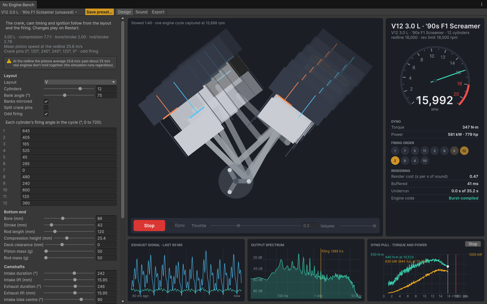
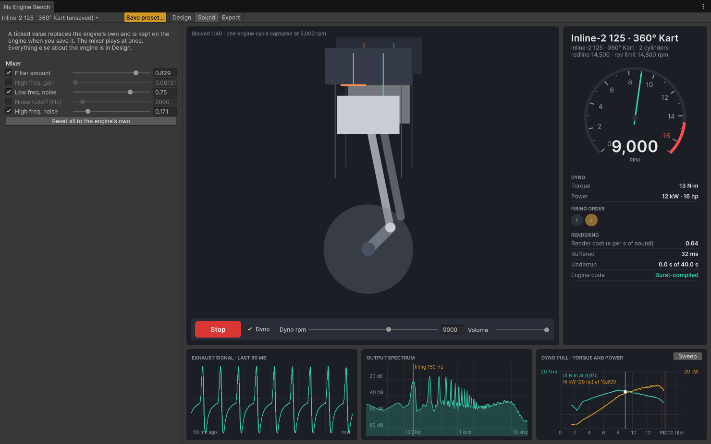
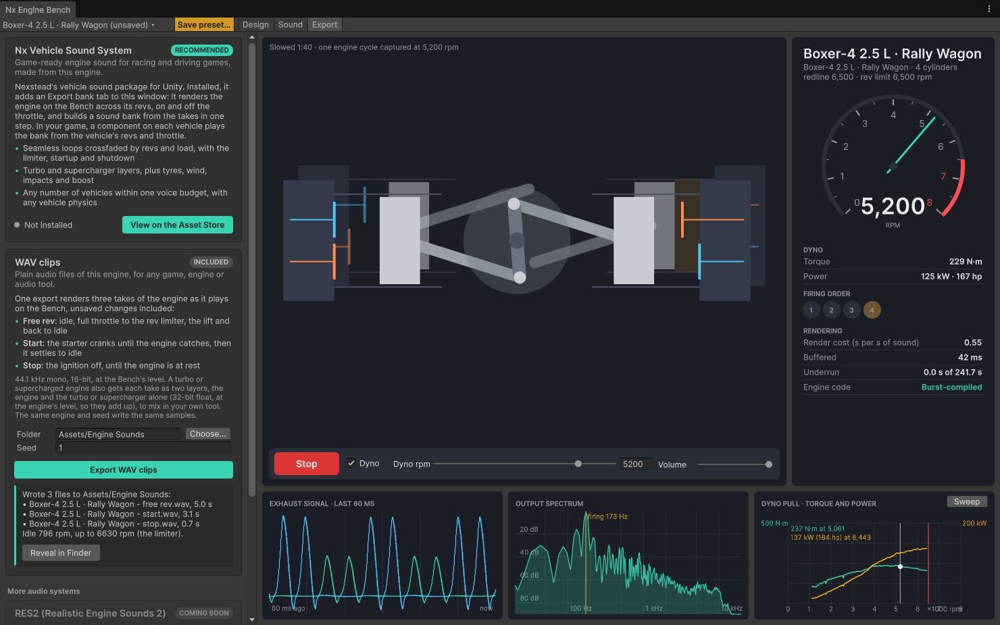

# Nx Engine Bench

A free, open-source engine and exhaust sound simulator for the Unity Editor,
based on [engine-sim](https://github.com/ange-yaghi/engine-sim) by Ange Yaghi.
Make engines from presets, tune their sound, listen to them live in the
Editor, and export a free rev, a start and a stop as WAV files. A render API
and Bench extensions let other tools build on it.

## In the Editor

Everything happens in one Editor window, **Window > Nx Engine Bench**. Each
shot below is a different engine running live in it. The engine view,
tachometer, dyno figures, exhaust signal, output spectrum and dyno curves all
come from the simulation as it plays. It ships 27 presets, from a single to a
V12: a single, V-twins, an inline twin, inline fours, fives and sixes, boxer
fours, V6s, V8s, a V10 and V12s.

### Design



A 3.0 L V12 F1 engine part-way through a dyno pull, at 15,500 rpm. Design
builds the engine from its layout, firing, bottom end, cams, head and intake,
exhausts, forced induction and limits, and flags a design real engines
wouldn't survive (here, the piston speed at the redline).

### Sound



A 125 cc 360° kart twin held on the dyno at 9,000 rpm. Sound tunes the mix,
which plays at once: a ticked value replaces the engine's own, and this preset
carries its own filter amount and noise.

### Export



A 2.5 L boxer four after an export. One click renders the free rev, the start
and the stop, and writes them as WAV files.

## Install

**Using it?** Install the package and read its documentation:
[Packages/com.nexstead.enginebench](Packages/com.nexstead.enginebench/README.md).

```
https://github.com/NEXSTEAD-GAMES/engine-sim-unity.git?path=/Packages/com.nexstead.enginebench
```

This repository is the package plus the Unity project and tools it is
developed and checked with.

## Try it as a user

From a clone, before or without publishing:

1. Create a new Unity 6 project (any template).
2. Window > Package Manager > **+** > **Install package from disk…**, and pick
   `Packages/com.nexstead.enginebench/package.json` in this repository.
3. In the Package Manager, select **Nx Engine Bench** > **Samples** >
   **Engine Demo** > **Import**.
4. Open `Assets/Samples/Nx Engine Bench/1.0.0/Engine Demo/Engine Demo.unity`
   and press **Play**: the small-block V8 starts on its own; hold **Space**
   for full throttle.
5. Open **Window > Nx Engine Bench**, pick an engine with the top bar's engine
   button, and press the green **Start**.

The package's [README](Packages/com.nexstead.enginebench/README.md) and
[manual](Packages/com.nexstead.enginebench/Documentation~/index.md) cover the
rest.

## Layout

| Path | What |
|---|---|
| `Packages/com.nexstead.enginebench/` | **the package** (what users install, and what goes on the Asset Store): runtime, Editor tools, presets, its own tests, documentation, licence and notices |
| `Tools~/RuntimeCheck` | an offline .NET compile check: the package's runtime without its Unity layer |
| `PORTING.md` | how the port is written and checked: read it before changing the simulation |

The repository root is the Unity project the package is developed in (Unity
6000.6.7f1, the package's minimum too). The C++ reference the port is checked
against, the parity tests and the tools that make the presets are kept apart,
in a private repository that checks out at `Assets/Reference` (ignored here).

## Checks

**Package tests** (`Nexstead.EngineBench.Tests`, a few minutes): the stream and
resampler, the partitioned convolution, the presets, engine copies and
saving, the sound tuning, the generator (determinism, no allocation once
running), the render API (bit-identical to the generator, the dyno holding
its rpm exactly, rendering on a worker thread, the limiter cut), forced
induction (its mix under the ceiling, its telemetry, the dense core matching,
the designer holding it), the exports (the engine fires, lengths, no sample
at full scale, the same seed the same samples, the WAV files) and the Bench's
extension discovery. They need nothing outside the package, so they also run
in any project that lists the package in `testables`. Headless, with no Editor
open on the project:

```bash
unity test . --mode EditMode --filter Nexstead.EngineBench.Tests
```

The port itself is checked against engine-sim built headless: on every
recorded golden run, both of its cores reproduce the reference's per-step
state bit for bit, the synthesizer's input with it, and an engine's forced
induction sound too.

## Offline tools

`Tools~/` builds with any .NET SDK (Unity's bundled one included), no network
and no Editor (outputs in `Tools~/bin` and `Tools~/obj`, git-ignored):

```bash
dotnet build "Tools~/RuntimeCheck"
```

`RuntimeCheck` compiles the package's runtime without its Unity layer
(`Runtime/Unity`) and with no Unity references: the simulation uses no Unity
API.

## Licence

MIT; see [LICENSE.md](LICENSE.md). Nx Engine Bench is based on engine-sim and
simple-2d-constraint-solver by Ange Yaghi (MIT): their notices are in the
package's [Third Party Notices.md](Packages/com.nexstead.enginebench/Third%20Party%20Notices.md).
Nx Engine Bench is not affiliated with or endorsed by Ange Yaghi or the
engine-sim project.
